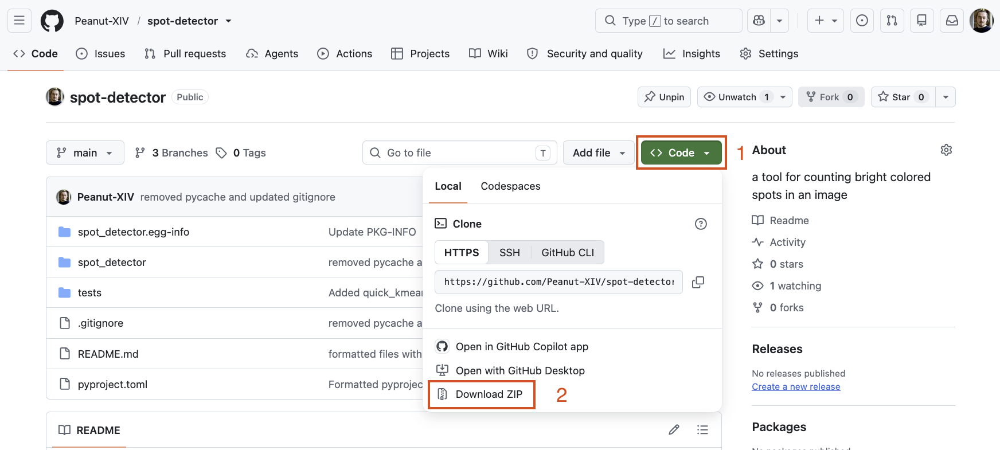

# Build

For the expected use-case, it is not necessary to build the project from source
since binaries for Spot Detector are available to download for macOS and
Windows.

However, you may need to edit the code for development purposes or to create a
binary for another platform. In this case, Spot Detector is written in Python
with common cross-platform libraries. It also takes advantage of PySide6's
`pyside6-deploy` tool to create executables for Linux, macOS and Windows. It
should therefore be relatively straightforward for you to create your own build
of the project by following this guide.

## Downloading the repository

In order to build the application, you need a copy of the project on your
machine. There are different options for downloading this repository. Depending
on your level of comfort.

### Downloading an archive of the repository (best for non-developers)

This is the best option if you do not have git installed on your machine. On
the [main page of the repository](https://github.com/Peanut-XIV/spot-detector/),
you can download an archive of the project by clicking on the green `Code`
expanding menu, then `Download ZIP` at the bottom of the menu that appears.



You can then extract the project [somewhere appropriate](#Appropriate-location) on your computer.

### Cloning the repository with git

This step requires having a version of git installed on your computer.
We will then be able to clone the spot-detector repository using the `git clone` command.

<details>
  <summary>
    On Windows
  </summary>

  In the Start menu, search for and select `Windows PowerShell` and click
  `Open`. A terminal window should appear. Then, enter the following command to
  go to a directory in which we will clone the project. You will need to enter
  the path to an [appropriate](#appropriate-location) existing directory of
  your choice.

```powershell
cd "C:\path\to\your\repo\directory\"
```

  > Note: You can also go in Windows' file explorer and copy the path to the
  > desired directory and paste it too.

  Now that you are in the correct location, run the cloning command to copy
  the repository on your computer :

```powershell
git clone "https://github.com/Peanut-XIV/spot-detector/"
```

  The command should execute without error. The repository is cloned and you
  can go to the next step.

</details>

<details>
  <summary>
  On macOS
  </summary>

  Launch Spotlight with `⌘ Space` then search and open `Terminal.app`. A terminal
  window should appear. Enter the following command to go to a directory in
  which we will clone the project. You will need to enter the path to an
  [appropriate](#appropriate-location) existing directory of your choice.

```zsh
cd ~/path/to/your/repo/directory/
```

  > Note: You can also go in the Finder and copy the path to the
  > desired directory with `⌥⌘ C`

  Now that you are in the correct location, run the cloning command to copy
  the repository on your computer :

```zsh
git clone "https://github.com/Peanut-XIV/spot-detector/"
```

  The command should execute without error. The repository is cloned and you
  can go to the next step.

</details>

<details>
  <summary>
  On a Linux distribution
  </summary>

  Open `GNOME Terminal`, `Konsole`, `Xfce Terminal` or even an other
  terminal emulator depending on your Linux distribution. A terminal window
  should appear. Enter the following command to go to a directory in
  which we will clone the project. You will need to enter the path to an
  [appropriate](#appropriate-location) existing directory of your choice.

```zsh
cd ~/path/to/your/repo/directory/
```

  > Note: You can also go in your file explorer and copy the path to the
  > desired directory

  Now that you are in the correct location, run the cloning command to copy
  the repository on your computer :

```zsh
git clone "https://github.com/Peanut-XIV/spot-detector/"
```

  The command should execute without error. The repository is cloned and you
  can go to the next step.

</details>

<!-- Maybe later
### Cloning the repository with Github Desktop
This step requires having Github Desktop installed on your computer.
 -->

## Making sure Python is installed and/or installing it

In this segment, we will try to check if python is installed, which versions
are available and how to install the correct version if necessary.

In the terminal, run the following command.

```bash
python3.12 -V
```


## Creating a Virtual Environment

## Building the application

## Storing the application

## Extra

### Appropriate location

Unless you make sure to delete the repository after you are done, I would
advise against saving the content of the project in a location that is
backed-up in the cloud (e.g. One Drive or iCloud) like the `Documents` or
`Desktop` directories often are. A good amount of data (~1 GB) will be saved
there in later steps, and it may contribute to bloating it. Also, if you use
git, it tends to interact badly with cloud backups. I would rather advise for a
dedicated development directory or even a temporary directory under your user
directory like `/Users/[your home directory]/build_from_source/` (macOS),
`C:\Users\[your home directory]\build_from_source\` (Windows) or `/home/[your home
directory]/build_from_source/` (Linux).
